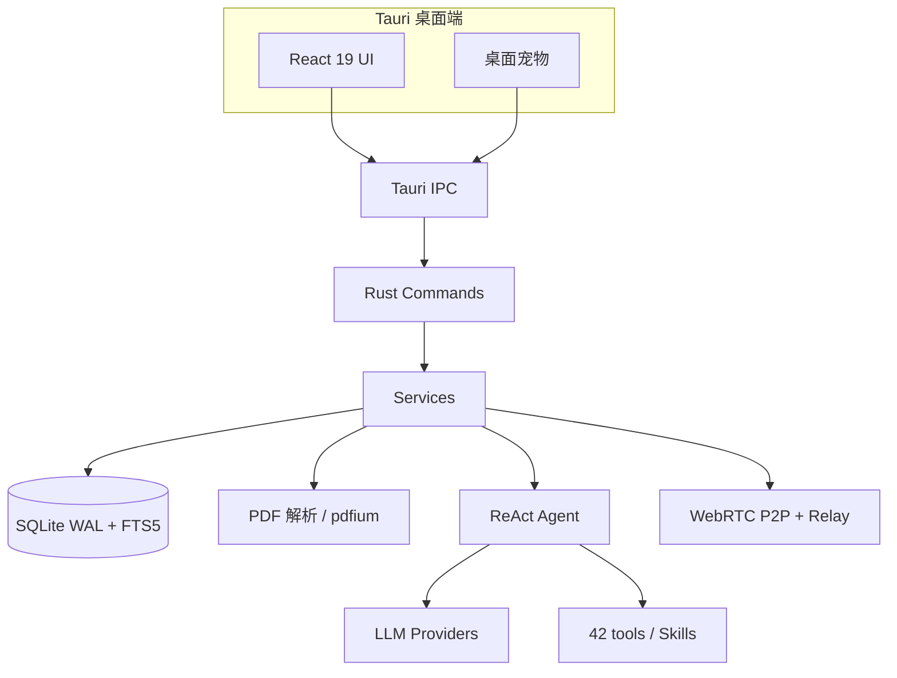

# 思库 Siku

**本地优先的 AI 科研工作台。**

在同一个本地知识库里读 PDF、做笔记、检索文献，并让 Agent 直接操作文件、浏览器、脚本和定时任务。

[](https://v2.tauri.app)
[](https://www.rust-lang.org)
[](https://react.dev)
[](https://www.typescriptlang.org)
[](https://pnpm.io)
[](https://github.com/seekpath-ai/siku/actions/workflows/release.yml)

[下载安装](#1-下载安装) · [5 分钟上手](#5-分钟上手) · [架构](#架构) · [功能状态](#功能状态) · [适用场景](#适用场景)


[观看完整演示（官网）](https://seekpath.com.cn/siku#demo)

## 30 秒了解

- **读得动**：Agent 直接读本地 PDF 全文，跳过参考文献和附录，结论带 chunk 引用
- **信得过**：点击引用回到 PDF 原文并高亮；两处证据可以连续核对
- **用得起来**：文献、笔记、科研追踪在同一个 SQLite 知识库里，Agent 可以继续读写、检索和执行工具

```text
导入 PDF → 阅读/提问 → 引用回跳 → 写进笔记 → 科研追踪 / 时间轴
```

## 思库解决什么

**把文献、PDF、笔记和 AI 放进同一个本地知识库。**

文献和笔记共享同一套集合层级，笔记里的引用能回到 PDF 原文。

**每个结论都能回到原文。**

回答带页码/块引用；点一下回到 PDF 原文并高亮。

**阅读会留下可回看的轨迹。**

阅读、摘录、笔记和科研发现进入时间轴；科研追踪还可以按课题关键词持续发现新论文。

思库把 AI 放进你已经积累的知识库，让对话直接落到文献、笔记和工具上。

## 核心能力

### PDF 阅读与可验证引用

- 本地 PDF 解析、分页、章节路径和块类型
- Agent 读全文，检索时默认跳过参考文献/附录
- 回答带引用，点击跳回原文位置并高亮
- 支持划词翻译、摘录和笔记引用

### 文献与笔记同库

- 文献管理与双链笔记在同一套知识库里，共用集合层级
- 在笔记视图下，文献集合层级保持一致
- 笔记引用链回 PDF 原文，双向链接形成知识图谱
- 笔记可导出 Markdown / PDF，对话可导出 Markdown

### Agent + 本地工具

- ReAct 引擎 + 42 个内置工具：文献、笔记、文件、浏览器、Shell、后台任务、长期记忆
- 工具按会话审批：只读工具自动放行，写/执行类工具需要确认
- 可挂载 Skill（文件夹/zip），支持「AI 审查」后再启用
- 支持 OpenAI / Anthropic / DeepSeek / SiliconFlow / Ollama / Qwen / Zhipu / Kimi / Gemini

### 科研追踪

- 按课题关键词从 arXiv、Crossref、Semantic Scholar 持续发现新论文
- LLM 标出与关键词的匹配度，帮助判断哪些值得读
- 有价值的文献可一键导入图书馆

### 本地优先与多设备

- 数据默认存本地 SQLite（WAL）+ 本地 blob
- 可选 WebRTC P2P + 中继邮箱做多设备同步，端到端加密
- 不登录同步账号也可以单机使用

### 远程接入（Beta）

- 微信 iLink、飞书机器人私聊/群聊
- 远程会话出现在本地对话列表
- 群里默认仅 @ 响应，按成员配对授权

详见 [远程接入文档](docs/remote-channels.md)。

## 5 分钟上手

### 1. 下载安装

从 [GitHub Releases](https://github.com/seekpath-ai/siku/releases/latest) 下载：

| 平台 | 安装包 |
|---|---|
| Windows | `.msi` / `-setup.exe`（NSIS） |
| macOS | `.dmg`（Universal，Apple Silicon 与 Intel 通用） |
| Linux | `.AppImage` / `.deb` / `.rpm` |

> macOS 安装包未做苹果公证。首次打开如被 Gatekeeper 拦截，请在「系统设置 → 隐私与安全性」中手动允许。

### 2. 配一个模型

打开「设置 → 模型」，填入任一 Provider 的 API Key；也可以先装 [Ollama](https://ollama.com/) 用本地模型跑通。

### 3. 导入第一篇 PDF

进入「图书馆 → 导入 PDF」，选择本地论文。等待解析和索引完成。

### 4. 提第一个问题

点击桌面宠物，选择「总结这篇文献」，或直接问：

```text
这篇论文的方法和主要结论是什么？请给出原文引用。
```

回答出现后，点击引用，检查是否能回到 PDF 原文并高亮。

### 5. 从源码运行

环境要求：

- Node.js >= 20
- pnpm >= 9
- Rust >= 1.78

```bash
git clone https://github.com/seekpath-ai/siku.git
cd siku
pnpm install

pnpm tauri dev      # 桌面应用
pnpm typecheck      # TypeScript 检查
pnpm lint           # ESLint
```

后端：

```bash
cd src-tauri
cargo check
cargo test
cargo clippy
```

## 配置

- **模型**：设置 → 模型，支持 OpenAI / Anthropic / DeepSeek / SiliconFlow / Ollama / Qwen / Zhipu / Kimi / Gemini
- **检索**：FTS5 开箱即用；语义检索可选，配置 OpenAI 兼容 `/v1` 端点后与关键词按 RRF 融合
- **网络搜索**：Bing / DuckDuckGo 默认回退，可加 Tavily / Brave / SearXNG
- **远程接入**：微信 iLink、飞书机器人，详见 [远程接入](docs/remote-channels.md)
- **日志**：`SIKU_LOG=debug pnpm tauri dev`，输出到 `~/.siku/logs/`

完整配置项见 [docs/configuration.md](docs/configuration.md)。

## 架构



**技术栈**

| 层级 | 技术 |
|---|---|
| 桌面框架 | Tauri 2 |
| 前端 | React 19 + TypeScript + Vite 6 |
| 样式 | Tailwind CSS + shadcn/ui |
| 状态/路由 | Zustand + TanStack Query / Router |
| 后端 | Rust |
| 数据库 | SQLite（WAL）+ sqlx |
| 检索 | FTS5（trigram）；可选向量召回 + RRF |
| PDF | pdfium-render + pdf_oxide 兜底 |
| Agent | ReAct + Tool Registry + SSE |

更细的项目结构：

```text
src/                 React 前端（reader / notes / research / chat）
src-tauri/src/       Rust 后端（commands / core / ai / pdf / sync）
src-tauri/src/remote/ 微信、飞书接入
docs/                工具清单、远程接入、对比文档
docs/media/          README 演示 GIF 与完整视频
```

## 功能状态

| 状态 | 功能 | 说明 |
|---|---|---|
| **Stable** | 本地文献库、PDF 阅读、引用回跳 | 主链路 |
| **Stable** | 笔记、双链、Markdown/PDF 导出 | 主链路 |
| **Stable** | Agent 对话、42 个内置工具 | 本地工具按审批执行 |
| **Stable** | FTS5 关键词检索 | 开箱即用 |
| **Beta** | 语义检索 | 需配置 OpenAI 兼容 embedding 端点 |
| **Beta** | 多设备同步 | WebRTC P2P + 中继，需登录同一账号 |
| **Beta** | 科研追踪 | 依赖 arXiv/Crossref 等外部源 |
| **Beta** | 微信/飞书远程接入 | 微信 iLink 协议非正式规范，可能随平台变化 |
| **Beta** | 浏览器自动化、Skill | 依赖本机浏览器与外部依赖 |
| **Planned** | 移动端 | 当前仅桌面端 |
| **Planned** | 团队协作/共享空间 | 当前面向个人知识库 |

### 路线图

- 移动端伴侣应用
- 团队协作/共享知识库
- 远程渠道的任务触发与完成推送
- 更完整的扫描版 PDF 处理

### 已知限制

- 当前只支持桌面端，没有 Web 版或移动端
- 扫描版 PDF 如果没有文字层，文本抽取会受限
- 远程接入依赖微信/飞书平台；消息会经过对应平台
- 多设备同步仍是 Beta；中继只转发密文，但需要网络和账号
- Agent 文件工具没有沙箱，写/执行类操作请看清审批卡

## 数据与安全

### 数据在哪

默认写入系统应用数据目录：

| 平台 | 路径 |
|---|---|
| Windows | `%APPDATA%\com.siku.reader` |
| macOS | `~/Library/Application Support/com.siku.reader` |
| Linux | `~/.local/share/com.siku.reader` |

核心文件：

```text
siku.db        SQLite 数据库
siku.db-wal    WAL
blobs/         PDF、图片等附件
```

日志默认在 `~/.siku/logs/`。

### 能导出什么

- 笔记：Markdown / PDF
- 对话：Markdown
- 整库备份：退出应用后复制 `siku.db` 和 `blobs/`
- PDF 原文件保留在本地，不会被改写

卸载应用不一定会删除应用数据目录；需要彻底清理时手动删除上面的目录。

### 同步与远程

- 同步内容端到端加密，中继只处理密文和路由所需元数据
- 远程微信/飞书消息会经过对应平台，和平台本身的隐私策略一致
- 使用云端 LLM 时，发送给模型的上下文会离开本机；用 Ollama 可完全离线

## 适用场景

| 你的需求 | 更适合 |
|---|---|
| 纯 Markdown 双链笔记 | 专用笔记工具 |
| 论文引用管理、文稿写作 | 文献管理工具 |
| 团队协作、数据库 | 团队文档工具 |
| 个人科研：PDF + 笔记 + AI + 本地数据 | **思库** |

完整对比见 [docs/comparison.md](docs/comparison.md)。

## 贡献与许可

- 开发环境、测试命令、PR 约定见 [CONTRIBUTING.md](CONTRIBUTING.md)
- 工具清单见 [docs/agent-tools.md](docs/agent-tools.md)
- 竞品与适用场景见 [docs/comparison.md](docs/comparison.md)

本项目采用 **Apache License 2.0 + Commons Clause**：

- 允许使用、修改、分发，以及嵌入更大的产品
- 禁止将本软件本身（或以其功能构成主要价值的衍生产品）直接出售或作为商业 SaaS 提供

详见 [LICENSE](LICENSE)。

---

🤖 Built with [Tauri](https://tauri.app) + [React](https://react.dev) + [Rust](https://www.rust-lang.org)
